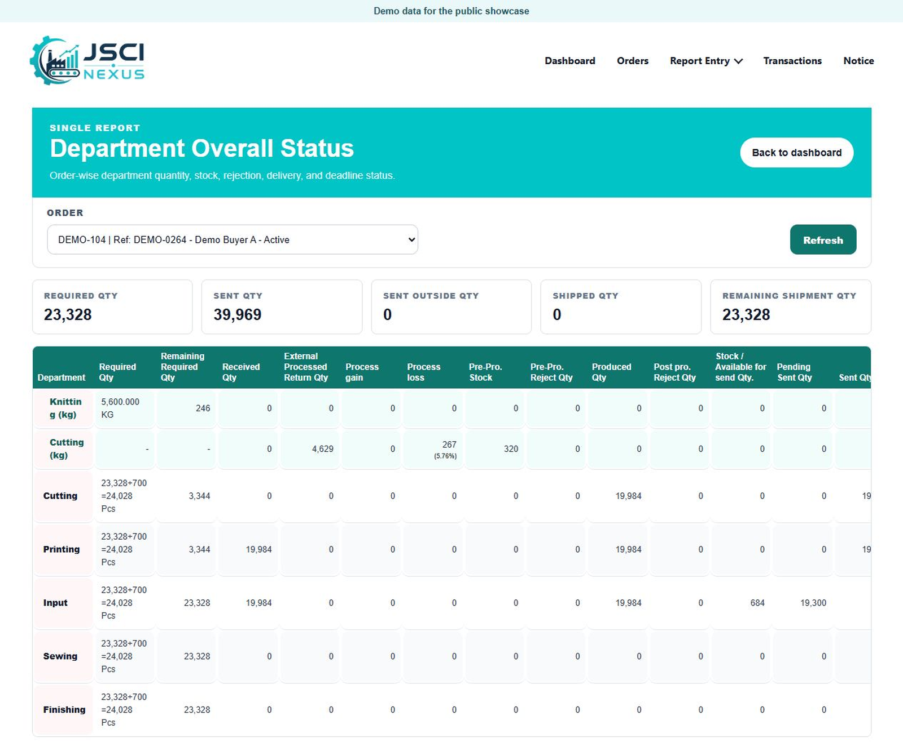
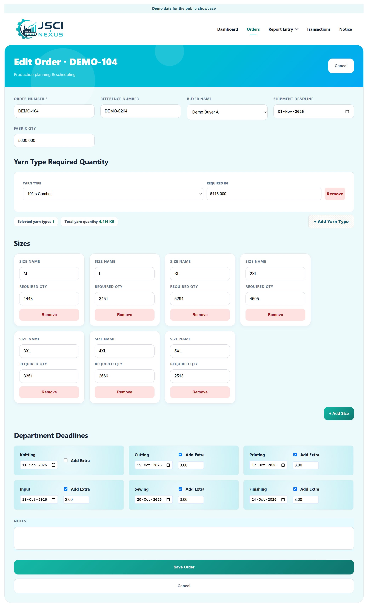
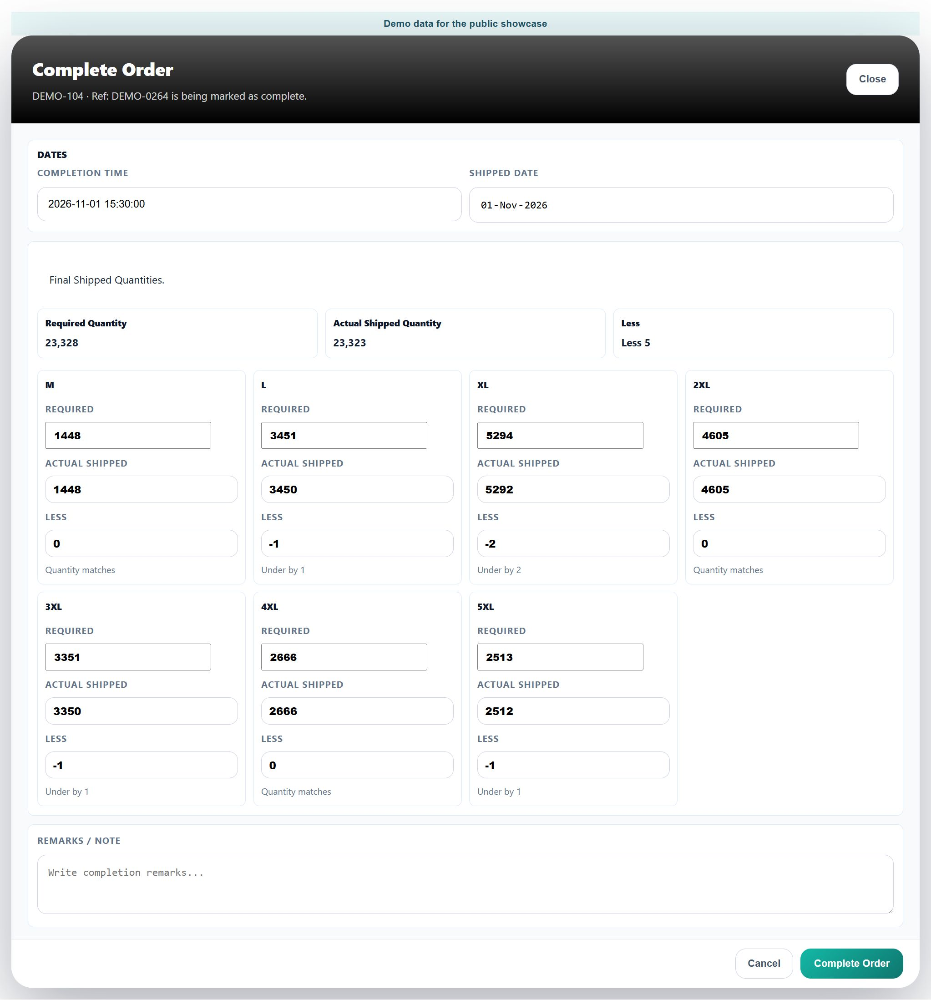
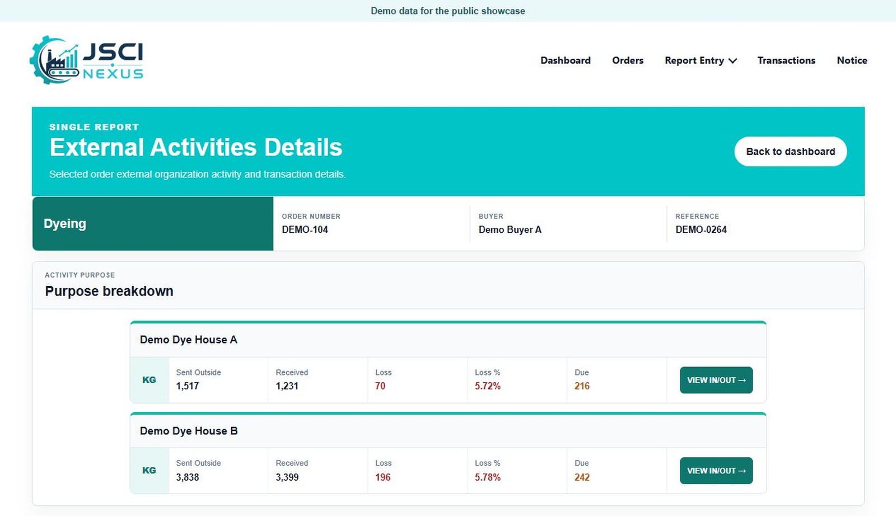

# JSCI NEXUS

**Garment production tracking from order to shipment**

I built JSCI NEXUS for **JS Cotton International**. Its production teams use it daily to plan orders, record work by department, confirm transfers, and see what still needs to happen before shipment.

[Production overview](#production-overview) · [Order workflow](#order-workflow) · [Materials](#materials-and-outside-processing) · [Built with](#built-with)

## Production overview

Supervisors can open an order and see how much each department has produced, sent, or still has on hand. The report also shows rejects and outstanding quantities.

*The reports use sample figures and fictional buyer and supplier names. Click any screenshot to open it at full size.*

## Order workflow

| Stage | What happens |
| --- | --- |
| **Plan** | Enter the required quantity by garment size, then set department deadlines and the shipment deadline. |
| **Record production** | Cutting records the fabric it used in kilograms and the pieces it cut in each size. |
| **Hand off a batch** | A transfer from Cutting to Input stays pending while the receiving team checks quantities. The app records who confirmed the transfer and when. |
| **Review progress** | A supervisor compares department targets with what was produced and sent, then opens the detailed report to check what is still due by size. |
| **Close the order** | Record what actually shipped and see how it compares with the ordered quantities. |

| Order planning | Order completion |
| --- | --- |
|  |  |
| Set quantities by size and due dates. | Compare the final shipped quantities with the order. |

### Department targets

Open a department to see which sizes still need work. In Cutting, the report shows both pieces by size and fabric used by weight.

## Materials and outside processing

| Yarn and knitting | Outside processing |
| --- | --- |
|  |  |
| Check yarn stock, fabric output, and process loss. | See what went out for processing, what came back, and what is still due. |

## What teams can manage

| Area | In daily use |
| --- | --- |
| **Orders and departments** | Follow order deadlines, department targets, production quantities, and transfers. |
| **Stock and outside work** | Check yarn and accessory stock and follow material sent out for dyeing or embroidery. |
| **Permissions and history** | Set access by department, line, and action. Review activity and share notices with staff. |

## Built with

JSCI NEXUS uses a custom WordPress plugin and theme, PHP and MySQL on the server, and JavaScript, HTML, and CSS in the browser. Its screens use the WordPress REST API.

Each transfer is linked to an order, with separate quantities for each garment size. The receiving queue, transaction history, and department reports use those same records.

## About this repository

This repository is a public showcase for an internal application. It contains the README and screenshots. Five images were enlarged from their original captures.

Built and maintained by **Sohan (Md. Sohanur Rahaman Khan)** for JS Cotton International. [GitHub profile](https://github.com/thisisohan) · [LinkedIn](https://linkedin.com/in/thisissohan/)
