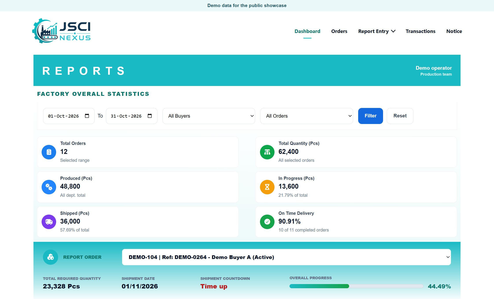
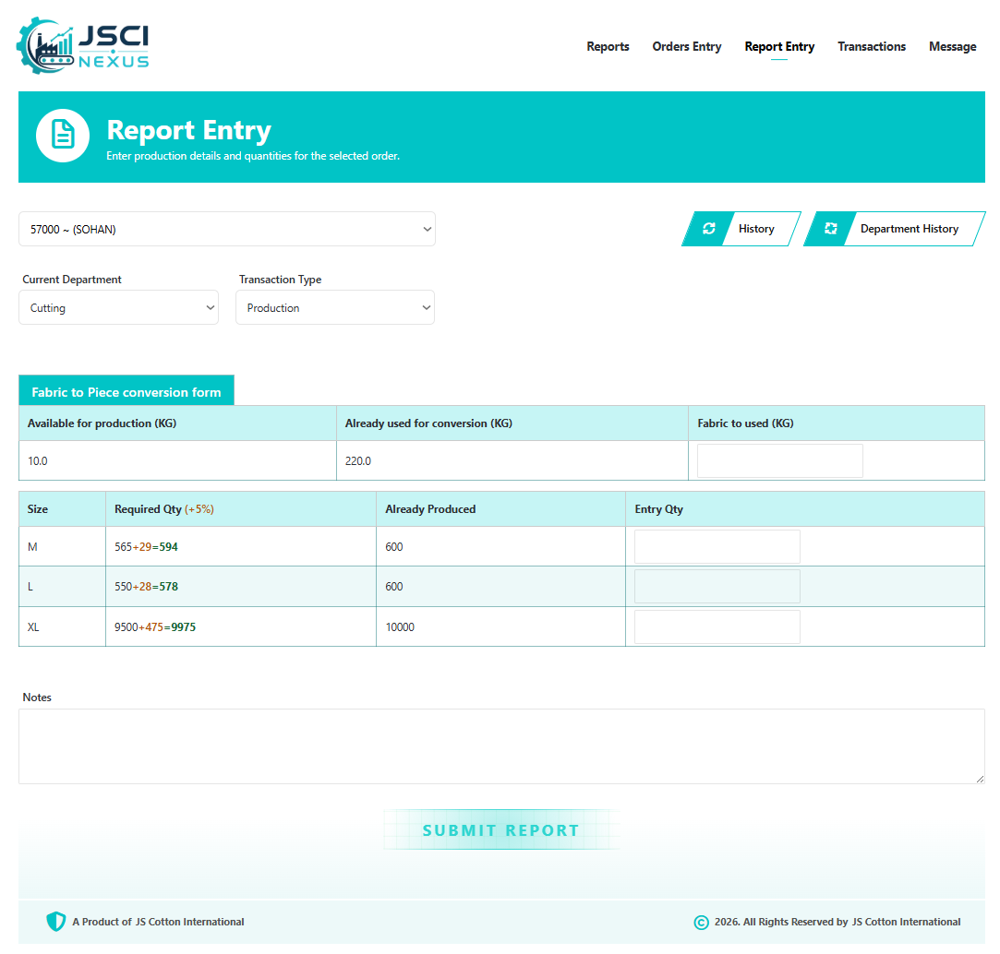
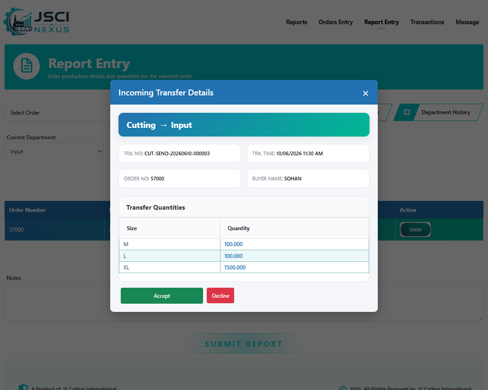
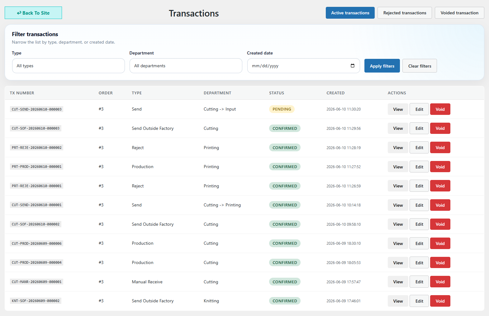
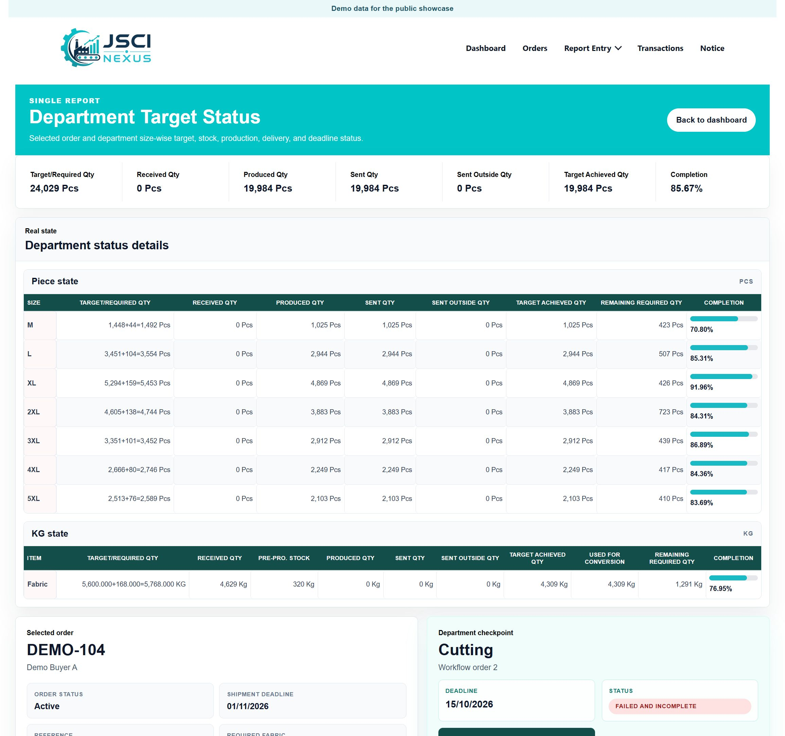
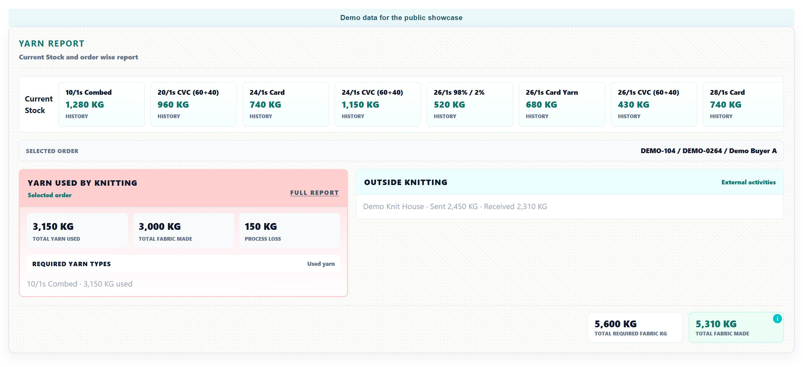
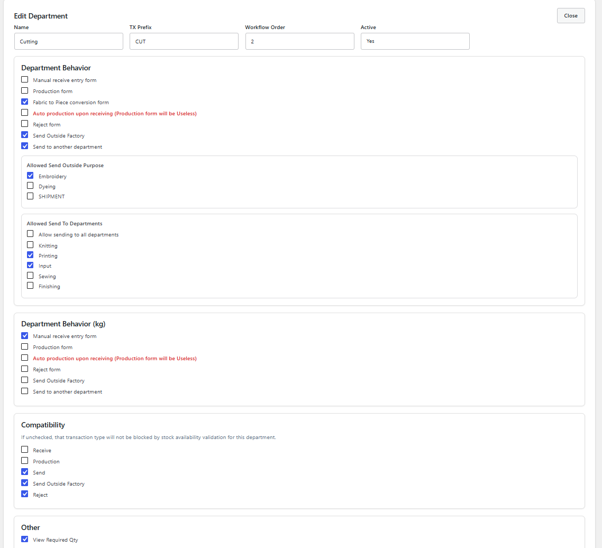
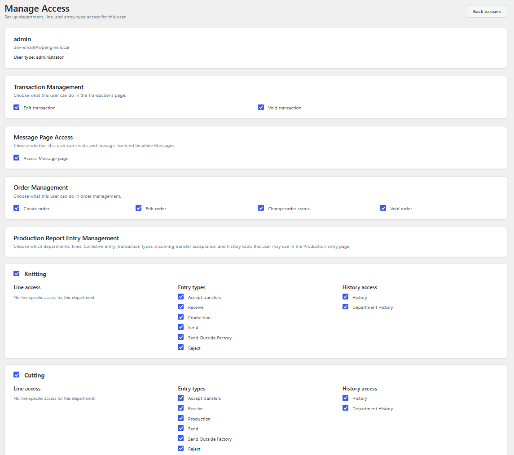
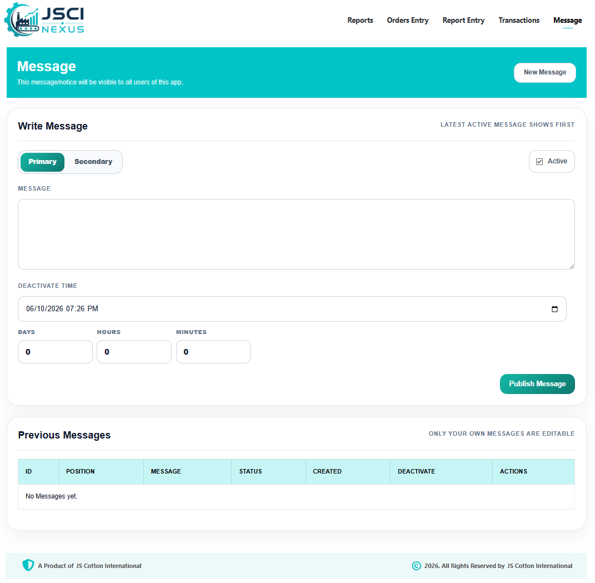

# JSCI NEXUS

**Garment production tracking from order to shipment**

I built JSCI NEXUS for **JS Cotton International**. Its production teams use it daily to plan orders, record work by department, confirm transfers, and see what still needs to happen before shipment.

[Case study](#case-study) · [Production overview](#production-overview) · [Order workflow](#order-workflow) · [Materials](#materials-and-outside-processing) · [Team settings and notices](#team-settings-and-notices) · [Built with](#built-with)

## Case study

Cutting can finish a batch while the next department is still waiting for it. I built JSCI NEXUS so a supervisor can see both stages from the same order.

1. **Plan the order.** In the demo, the team plans 23,328 garments, broken down by size, and sets deadlines for each department and for shipment. [Order planning screen](assets/screenshots/order-planning.png)
2. **Hand off a batch.** Cutting records the pieces it produces and sends a batch to Input. The transfer stays pending while Input checks the quantities by size. If Input accepts the batch, the system records who confirmed it and when. [Incoming transfer screen](assets/screenshots/incoming-transfer.png)
3. **Find what’s still due.** The supervisor compares what each department has produced, sent, and received. If Cutting is behind, the supervisor opens its target report to see which garment sizes still need work. [Department overview](#department-overview) · [Department targets](#department-targets)

## Production overview

### Factory dashboard

See production and shipment totals at a glance, then select an order to check its progress and deadline. Click any screenshot to open the full-resolution image.

### Department overview

Supervisors can open an order and see how much each department has produced, sent, or still has on hand. The report also shows rejects and outstanding quantities.

*The department and materials reports use sample figures and fictional buyer and supplier names.*

## Order workflow

| Stage | What happens |
| --- | --- |
| **Plan** | Enter the required quantity by garment size, then set department deadlines and the shipment deadline. |
| **Record production** | Cutting records the fabric it used in kilograms and the pieces it cut in each size. |
| **Hand off a batch** | A transfer from Cutting to Input stays pending while the receiving team checks quantities. The app records who confirmed the transfer and when. |
| **Review progress** | A supervisor compares department targets with what was produced and sent, then opens the detailed report to check what is still due by size. |
| **Close the order** | Record what actually shipped and see how it compares with the ordered quantities. |

| Order planning | Order completion |
| --- | --- |
|  |  |
| Set quantities by size and due dates. | Compare the final shipped quantities with the order. |

### Production and transfers

These earlier screens show how teams record work and confirm handoffs on a demo order.

| Cutting entry | Incoming transfer |
| --- | --- |
|  |  |
| Record the fabric used and the number of pieces cut in each size. | Review sizes and quantities before accepting or declining a batch. |

### Transaction history

Find production entries, rejects, and transfers by date, department, or type. Status labels show what is pending and what has been confirmed.

### Department targets

Open a department to see which sizes still need work. In Cutting, the report shows both pieces by size and fabric used by weight.

## Materials and outside processing

| Yarn and knitting | Outside processing |
| --- | --- |
|  |  |
| Check yarn stock, fabric output, and process loss. | See what went out for processing, what came back, and what is still due. |

## Team settings and notices

| Department settings | Access management |
| --- | --- |
|  |  |
| Choose what a department can record and where it can send work. | Set which actions a user can take in each department. |

### Internal notices

Post a notice for staff and choose when it expires.

## What teams can manage

| Area | In daily use |
| --- | --- |
| **Orders and departments** | Follow order deadlines, department targets, production quantities, and transfers. |
| **Stock and outside work** | Check yarn and accessory stock and follow material sent out for dyeing or embroidery. |
| **Permissions and history** | Set access by department, line, and action. Review activity and share notices with staff. |

## Built with

JSCI NEXUS uses a custom WordPress plugin and theme, PHP and MySQL on the server, and JavaScript, HTML, and CSS in the browser. Its screens use the WordPress REST API.

Each transfer is linked to an order, with separate quantities for each garment size. The receiving queue, transaction history, and department reports use those same records.

## About this repository

This repository is a public showcase for an internal application. It contains the README, high-resolution report and order captures, and earlier demo screenshots.

Built and maintained by **Sohan (Md. Sohanur Rahaman Khan)** for JS Cotton International. [GitHub profile](https://github.com/thisisohan) · [LinkedIn](https://linkedin.com/in/thisissohan/)
